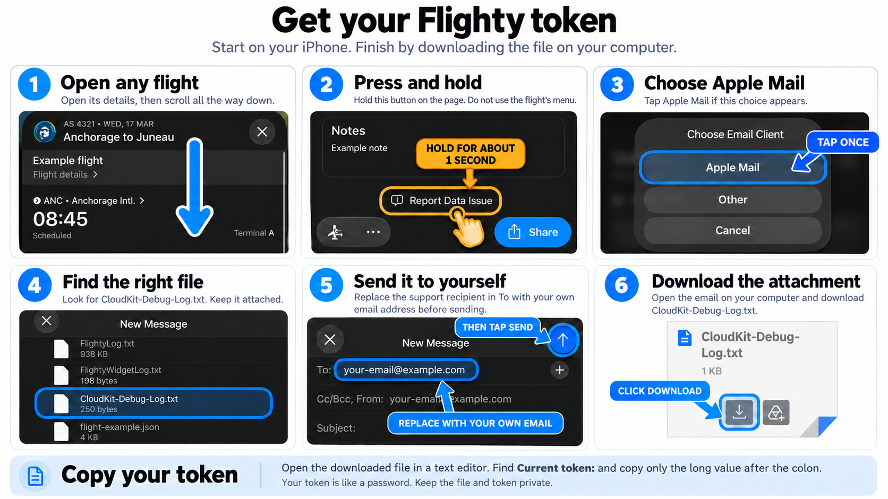

# flighty-mcp (Cloudflare Workers)

An unofficial MCP server for [Flighty](https://flighty.com), hosted as a remote MCP server on
Cloudflare Workers. Forked from [swiftyspiffy/flighty-mcp](https://github.com/swiftyspiffy/flighty-mcp).

Clients connect to `https://flighty-mcp.odell.io/mcp` and sign in with Cloudflare Access.
The Worker does not accept a static `MCP_TOKEN` bearer. `FLIGHTY_TOKEN` is still the upstream
Flighty credential. A client may send `X-Flighty-Token` to use a different Flighty account
than the one in that secret.

Not affiliated with or endorsed by Flighty. **Adding and editing are enabled by
default. Account deletion is disabled.**

## Why the account cache exists

A full Flighty sync is several protobuf pages. Decoding every page with
`@bufbuild/protobuf` while retaining raw bytes, unknown fields, ProtoJSON copies, and a
cloned snapshot exceeds the Workers **128 MB** isolate memory limit (error 1102) even
when CPU time stays well under the 30 second Paid-plan limit.

Reads (`list_flights`, `get_account_records`, catalog search, `sync_account`) are served
from D1. A refresh decodes **one page at a time**, writes the trimmed records, drops the
protobuf message and raw bytes, and checkpoints the cursor. The default account's
remaining pages continue as Queue messages, one page per invocation. The published
generation flips only after the last page, so a crash cannot replace a good snapshot
with a partial one. Cron `0 * * * *` enqueues that refresh every hour.

Tracked flights and friends' flights are stored. `list_flights` with
`mine_only=false` returns them, with `owner_name`, `friend_id`, `shared`, and
`relationship`. `mine_only=true` stays limited to this account's My Flights.
`get_flight` serves a cached flight, including a friend's, before calling
Flighty. `get_account_records` for flight categories stays limited to this account.

## Deploying

GitHub Actions (`.github/workflows/deploy.yml`) type-checks, tests, applies D1
migrations, deploys, then deletes the unused `MCP_TOKEN` secret on every push to
`main`. These resources are already provisioned on account
`d07b110f410fe3016dae9409da71b2ba` and recorded in `wrangler.jsonc`:

| Binding | Name | ID |
| --- | --- | --- |
| `DB` | `flighty-mcp` | `42bfcf77-8ba9-4c1a-b06b-fe443cf62cd1` |
| `SYNC_QUEUE` | `flighty-mcp-sync` | `199a638623e4490fabd771415783aa95` (bound by queue name) |

`migrations/0001_account_cache.sql` is already applied remotely and recorded in
`d1_migrations`, so `wrangler d1 migrations apply flighty-mcp --remote` is a no-op
until a later migration is added. Friends' and tracked flights did not need a new
table.

The API token used by Wrangler and `CLOUDFLARE_API_TOKEN` needs permission to deploy
Workers, create a custom hostname on the `odell.io` zone, edit D1, KV, and Queues.
`odell.io` must be on the same Cloudflare account. `CLOUDFLARE_ACCOUNT_ID` is
`d07b110f410fe3016dae9409da71b2ba`.

### 1. D1

Already created. To recreate:

```bash
npx wrangler d1 create flighty-mcp
npx wrangler d1 migrations apply flighty-mcp --remote
```

### 2. Queue

`flighty-mcp-sync` already exists. The Worker produces and consumes it
(`max_concurrency` 1, one message at a time).

### 3. Custom domain

`wrangler.jsonc` contains:

```jsonc
{ "pattern": "flighty-mcp.odell.io", "custom_domain": true }
```

Deploy creates the DNS record and certificate on the `odell.io` zone. The canonical
MCP URL is `https://flighty-mcp.odell.io/mcp`.

### 4. Cloudflare Access (self-hosted application with Managed OAuth)

Authentication is handled by Cloudflare Access, not by this Worker. Access runs the OAuth flow
with MCP clients and forwards each request with a signed `Cf-Access-Jwt-Assertion` JWT, which the
Worker verifies on every `/mcp` request (RS256 signature against the team's keys, issuer, audience
and expiry). Who may connect is decided only by the Access policy. See
[Secure MCP servers with Access](https://developers.cloudflare.com/cloudflare-one/access-controls/ai-controls/secure-mcp-servers/)
and [Managed OAuth](https://developers.cloudflare.com/cloudflare-one/access-controls/applications/http-apps/managed-oauth/).

1. Go to **Zero Trust → Access controls → Applications → Add an application → Self-hosted**.
2. Name it `flighty-mcp`, set the public hostname to `flighty-mcp.odell.io` (no path).
3. Turn on **Managed OAuth** under Advanced settings.
4. Add one **Allow** policy that includes the emails that may connect. No Bypass or Everyone rules.
5. Copy the application's **Audience (AUD) tag**.

### 5. Worker secrets

`FLIGHTY_TOKEN` and `ACCESS_AUD` are Worker secrets. To set or rotate one:

```bash
npx wrangler secret put FLIGHTY_TOKEN
npx wrangler secret put ACCESS_AUD
```

`ACCESS_TEAM_DOMAIN` (`aodell.cloudflareaccess.com`) is a plain var in `wrangler.jsonc`.
`wrangler deploy` stops if `ACCESS_AUD` is missing, and if either Access value is unset `/mcp`
fails closed with a 500. Do not commit any of these values.

`MCP_TOKEN` is no longer read. The deploy workflow runs `wrangler secret delete MCP_TOKEN` after a successful deploy and ignores a secret that is already gone. To remove it yourself:

```bash
npx wrangler secret delete MCP_TOKEN
```

Optional secret: `FLIGHTY_BUILD_TOKEN`.

Non-secret vars stay in `wrangler.jsonc`:

- `FLIGHTY_ALLOW_WRITES=true`
- `FLIGHTY_ALLOW_ACCOUNT_DELETION=false`

### 6. Deploy

```bash
npx wrangler deploy
```

Or merge to `main` and let GitHub Actions test, release, apply migrations and deploy
(see [Releases](#releases)). The action
needs repository secrets `CLOUDFLARE_API_TOKEN` and `CLOUDFLARE_ACCOUNT_ID`.
`FLIGHTY_TOKEN` and the Access secrets stay Worker secrets. They are not GitHub
Actions secrets.

`GET /health` does not require a login.

## Releases

Releasing is automatic, using [semantic-release](https://semantic-release.gitbook.io) and [Conventional Commits](https://www.conventionalcommits.org) (config in `.releaserc.json`), the same as `imessage-mcp`. Pull requests run **Test**. On each push to `main`, **Deploy Worker** runs the tests, then semantic-release reads the commits since the latest `vX.Y.Z` tag:

| Commit | Release |
|---|---|
| `feat: …` | minor |
| `fix: …`, `perf: …`, `revert: …`, `deps: …` | patch |
| `feat!: …` (any type with `!`), or `BREAKING CHANGE:` in the body | major |
| `docs:`, `chore:`, `ci:`, `test:`, `refactor:`, anything else | none |

A release creates the `vX.Y.Z` tag and a GitHub Release with notes grouped by type. The Worker deploys on every push either way, with `git describe` passed as `APP_VERSION` (`0.4.0` right after a release, `0.4.0-3-gabc1234` for unreleased commits). `/health`, the MCP handshake and `get_server_info` report it. A plain `npx wrangler deploy` reports `0.0.0-development`. Nothing is committed to `main`; the committed `package.json` version stays `0.0.0-development` and the tags are the source of truth. **Give PRs a Conventional title**, such as `feat: add get_server_info`. A squash merge uses the title as the commit message, and for a "Merge pull request #N" commit semantic-release reads the title on the line after it.

## Connecting a client

| Setting | Value |
| --- | --- |
| Server URL | `https://flighty-mcp.odell.io/mcp` |
| Auth | Cloudflare Access Managed OAuth. The client discovers Access's OAuth endpoints from the `401` response and the user signs in through Access. |
| Optional header | `X-Flighty-Token: <Flighty token>` overrides `FLIGHTY_TOKEN` for that request |

Claude Code:

```bash
claude mcp add --transport http --scope user flighty https://flighty-mcp.odell.io/mcp
```

The first connection opens a browser to sign in through Access. There is no `Authorization: Bearer <MCP_TOKEN>` header.

Then ask **"Use Flighty to show my upcoming flights."** If the cache is empty, ask it
to call `refresh_cache` or wait for the hourly sync.

## Get your Flighty token

On your iPhone:

1. Open a flight and scroll down its details page to **Report Data Issue**.
2. **Press and hold that standalone button for about one second.** Use the button
   on the page, not the item inside the flight’s menu.
3. Choose **Apple Mail** if prompted. Find **CloudKit-Debug-Log.txt** in the draft.
4. Save the attachment to your computer. If you email it to yourself, replace the
   support recipient with your own address first.
5. Open the file in a text editor and find **`Current token:`**. Copy just the long
   value after the colon, without spaces or quotation marks.

[](docs/images/flighty-token-guide.png)

**Keep this token and the attachment private. They give access to your account.**
The regular Settings → Help email usually includes only app logs. These steps
were verified with Flighty 4.11.1; the shortcut may change.

## Configuration

Non-secret settings are Worker vars (`vars` in `wrangler.jsonc` or the dashboard).

| Variable | Default | Purpose |
| --- | --- | --- |
| `FLIGHTY_TOKEN` (secret) | none | Flighty account credential. `X-Flighty-Token` overrides it |
| `ACCESS_AUD` (secret) | none | Audience (AUD) tag of the Access application; `/mcp` rejects tokens for any other audience |
| `ACCESS_TEAM_DOMAIN` | `aodell.cloudflareaccess.com` | Access team domain used to fetch signing keys and check the issuer |
| `FLIGHTY_ALLOW_WRITES` | `true` | Set to `false` for read-only access |
| `FLIGHTY_ALLOW_ACCOUNT_DELETION` | `false` | Separate account-deletion permission |
| `FLIGHTY_CACHE_TTL` | `120` | In-memory snapshot lifetime, used only when D1 is not bound |
| `FLIGHTY_SYNC_PAGES_PER_RUN` | `1` | Sync pages decoded in one Worker invocation before the queue continues |
| `FLIGHTY_TIMEOUT` | `60` | Upstream request timeout in seconds |
| `FLIGHTY_MAX_PAGES` | `100` | Maximum pages per account sync |
| `FLIGHTY_LOCALE` / `FLIGHTY_USER_AGENT` / `FLIGHTY_DEVICE_ID` | app defaults | Request header overrides |
| `FLIGHTY_BUILD_TOKEN` (secret) | none | Optional app build token header |

Observability logs and traces are enabled in `wrangler.jsonc` at a sampling rate of 1,
which fits a single-user Worker. Lower `observability.traces.head_sampling_rate` if
trace volume grows.

## API and tools

| Tools | What they do |
| --- | --- |
| `list_flights`, `sync_account`, `get_account_records`, `refresh_cache` | Read the cached account. Responses include `cache_age_seconds` and `last_refreshed`. `refresh_cache` and `refresh: true` start a sync |
| `search_flights`, `get_flight`, `poll_flight` | Search schedules and check flight details |
| `search_airports`, `search_airlines`, `search_aircraft_types`, `search_metro_areas` | Resolve names and codes from the cache |
| `get_schema`, `get_endpoint_catalog` | Explore supported routes and protobuf fields |
| `get_server_info` | Running version and when that Worker version was deployed |
| `subscribe_flight`, `delete_flight`, `set_flight_archived`, `set_flight_mine` | Track, remove and organize flights |
| `update_ticket`, `set_flight_note`, `upsert_manual_flight` | Edit bookings, notes and manual flights |
| `apply_changes` | Advanced access to all 43 sync actions |
| `wait_for_sync` | Wait for an update notification |

Additional tools cover airport boards, radar, imports/exports, sharing and friends.
Browse the [full endpoint list](docs/endpoints.md), [sync actions](docs/sync-actions.md)
and [API contracts](docs/api.md).

Resources: `flighty://flights/{when}`, `flighty://account/{kind}` and
`flighty://schema/{name}`. Account resources return up to 200 records; tools support pagination.

## Upstream concerns

- **Unofficial API:** New Flighty versions may require verifying protobuf
  definitions, routes, headers and the token-export shortcut.
- **Writes are experimental:** Live validation is limited. Supervise changes and
  verify saved values. Account deletion has a separate switch.
- **Updates may replace fields:** Omitted fields can clear existing values in generic
  sync actions. `update_ticket` merges current data before changing supplied fields.
- **Ticket timestamps:** Flighty may reset `created` when a ticket is edited.
  `update_ticket` preserves other editable ticket values, not server-owned timestamps.
- **Request pacing:** Manual refreshes reuse a complete snapshot for 60 seconds.
  The hourly cron refreshes the default `FLIGHTY_TOKEN` account. Writes enqueue a
  refresh for that account. Server quotas are undocumented; writes are never retried
  automatically.
- **Credentials can change:** Account tokens may be rejected or revoked.
  An observed JWT without an expiry claim does not guarantee permanent access.

## Local development

```bash
npm install
npm run typecheck
npm test
```

Copy `.dev.vars.example` to `.dev.vars` and fill in secrets to hit Flighty.
Tests use synthetic fixtures with a mocked `fetch` and never reach Flighty.
Protobuf messages are built at runtime from `src/data/schema.json` with
[`@bufbuild/protobuf`](https://github.com/bufbuild/protobuf-es).

```bash
npm run dev
```

`wrangler dev` uses a local D1 and KV. Apply the migration locally with
`npx wrangler d1 migrations apply flighty-mcp --local` if the dev session does not
create the tables itself.  `/mcp` still requires an Access-issued JWT, so test authenticated calls against the deployed hostname.

## License

[MIT](LICENSE) · Copyright (c) 2026 Cole Jelinek.

Inspired by [obeone/parcelapp-mcp](https://github.com/obeone/parcelapp-mcp).
