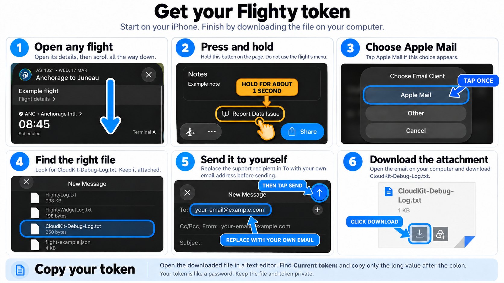

# ✈️ flighty-mcp

[](https://github.com/swiftyspiffy/flighty-mcp/actions/workflows/ci.yml)

[](https://github.com/swiftyspiffy/flighty-mcp/pkgs/container/flighty-mcp)
[](LICENSE)


An unofficial MCP server for [Flighty](https://flighty.com). Let your AI assistant
read your flights, search schedules and airports, and manage your tracked flights.
Works locally or in Docker, over stdio or streamable HTTP.

**Does NOT require macOS. Runs on any OS, including Windows, Linux and macOS.**

**Flighty does NOT need to be open or running.** Once you have your account token,
the MCP connects directly to Flighty's servers.

Not affiliated with or endorsed by Flighty. **Adding and editing are enabled by
default. Account deletion is disabled.**

## ✅ Requirements

- **Windows, Mac, or Linux machine with Docker** for the recommended setup, or with
  **Python 3.11+** for a local install.
- **Flighty on iPhone or Mac** to get your account token.

## 🚀 Features

| | Feature |
| --- | --- |
| ✈️ | List upcoming, past, archived and manual flights; filter by route or date |
| 🔍 | Search flights, airports, airlines and aircraft |
| 📡 | Check flight details, airport boards, status and radar data |
| 📝 | Manage tracked flights, notes, seats, bookings and manual entries |
| 🧩 | 48 tools for flight tracking and account features |
| 🔐 | Your Flighty account token stays in your own setup |
| 🐳 | Ready-to-run Docker image for Intel/AMD and Apple Silicon |

Core flight-management features have been live-tested, including creation,
editing, archiving and deletion of regular and manual test flights. Social
features and account deletion have not been live-tested. Additional account and
integration features also have automated/mock coverage only; see
[test coverage](docs/testing.md#live-validation-status).

## ⚡ Quickstart: AI first

Give your agent the following prompt:

```text
Install and configure flighty-mcp for my MCP client on this computer:
https://github.com/swiftyspiffy/flighty-mcp

Read the README and the guide for my client first. Detect my operating system
and use commands appropriate for Windows, macOS, or Linux. Ask which MCP client
I use if it is unclear.

Prefer the prebuilt ghcr.io/swiftyspiffy/flighty-mcp:latest image if Docker is
available. Otherwise, install from the repository's source archive in an isolated
Python 3.11+ environment. Do not clone or build the Docker image.

Preserve my existing MCP settings. Guide me through getting the Flighty diagnostic
attachment using the README, then import its token locally without displaying it
or committing it. Leave ordinary writes enabled and account deletion disabled.

Verify the connection and list my upcoming flights using read-only tools.
If software is missing or my client requires a hosted connection, explain the
next setup step instead of claiming installation is complete.
```

Your agent can handle the computer setup. You'll still need Flighty on your
iPhone or Mac to get the account token. The steps below also work for manual setup.

### 1. Get your Flighty token

On your iPhone:

1. Open a flight and scroll down its details page to **Report Data Issue**.
2. **Press and hold that standalone button for about one second.** Use the button
   on the page, not the item inside the flight’s menu.
3. Choose **Apple Mail** if prompted. Find **CloudKit-Debug-Log.txt** in the draft.
4. Save the attachment to your computer. If you email it to yourself, replace the
   support recipient with your own address first.
5. Open the file in a text editor and find **`Current token:`**. Copy just the long
   value after the colon, without spaces or quotation marks.

[](docs/images/flighty-token-guide.png)

**Keep this token and the attachment private. They give access to your account.**
The regular Settings → Help email usually includes only app logs. These steps
were verified with Flighty 4.11.1; the shortcut may change.

### 2. Connect your AI app

For manual setup, install and open [Docker Desktop](https://www.docker.com/products/docker-desktop/),
or use the Python install below. Then follow your app's guide in [Using the MCP](#using-the-mcp).
Docker downloads the image automatically the first time; keep Docker running
while you use Flighty MCP.

### 3. Try it

Ask **“Show my upcoming flights”** or **“Find my flights from Seattle last year.”**
Reading and editing work immediately. Changes should follow your explicit request.

## 📦 Other installation options

### Local, without Docker

Install [uv](https://docs.astral.sh/uv/getting-started/installation/), then run:

```bash
uv tool install "flighty-mcp @ https://github.com/swiftyspiffy/flighty-mcp/archive/refs/heads/main.zip"
```

For clients using JSON configuration, use the token you copied above.
For Codex, follow the local-install option in its [app guide](docs/chatgpt-codex.md).

```json
{
  "mcpServers": {
    "flighty": {
      "command": "flighty-mcp",
      "env": {"FLIGHTY_TOKEN": "PASTE_YOUR_FLIGHTY_TOKEN_HERE"}
    }
  }
}
```

No repository checkout needed. If your AI app cannot find `flighty-mcp`, use its
full path; `uv tool dir --bin` shows the folder containing it.

### Docker with an HTTP connection

For MCP clients that accept a server URL and custom headers, run:

```bash
docker run -d --name flighty-mcp -p 127.0.0.1:8000:8000 ghcr.io/swiftyspiffy/flighty-mcp:latest
```

In your client, use:

| Setting | Value |
| --- | --- |
| Server URL | `http://127.0.0.1:8000/mcp` |
| Header name | `X-Flighty-Token` |
| Header value | Your Flighty token |

Keep the token in your client’s header settings. HTTP requests each need a token;
setting a token on the container does not replace this step. For a server on
another computer, see [remote connections](docs/usage.md#http-credentials).

## Using the MCP

Choose your app for step-by-step setup:

| App | Guide |
| --- | --- |
| ChatGPT / Codex | [Desktop, Codex and ChatGPT web setup](docs/chatgpt-codex.md) |
| Claude | [Claude Desktop and Claude Code setup](docs/claude.md) |

Once connected, ask naturally:

- **“Use Flighty to show my upcoming flights.”**
- **“Find my flights from Seattle last year.”**
- **“Find Seattle-to-Portland flights next Friday, but don't add anything.”**

Reading, searching, adding and editing work by default. Check the date and flight
number before approving a change.

## ⚙️ Configuration

Adding and editing flights are enabled by default. For read-only access, set
`FLIGHTY_ALLOW_WRITES=false` in your server environment and restart your client.
The app guides above show how to pass this setting into Docker. Account deletion
stays off unless separately enabled.

| Variable | Default | Purpose |
| --- | --- | --- |
| `FLIGHTY_TOKEN` / `FLIGHTY_TOKEN_FILE` | none | Account credential for stdio; choose one |
| `FLIGHTY_ALLOW_WRITES` | `true` | Set to `false` for read-only access |
| `FLIGHTY_ALLOW_ACCOUNT_DELETION` | `false` | Separate account-deletion permission |
| `FLIGHTY_CACHE_TTL` | `120` | Account cache lifetime in seconds |
| `FLIGHTY_TIMEOUT` | `60` | Upstream request timeout in seconds |
| `FLIGHTY_MAX_PAGES` | `100` | Maximum pages per account sync |
| `FLIGHTY_TRANSPORT` | `stdio` | `stdio` or `streamable-http` |
| `FLIGHTY_HOST` / `FLIGHTY_PORT` | `127.0.0.1` / `8000` | HTTP bind address/port; Docker binds `0.0.0.0` |
| `FLIGHTY_PATH` | `/mcp` | HTTP endpoint |

See [advanced usage](docs/usage.md#configuration) for locale, device/version headers
and transport flags. Keep credentials out of Git and Docker build arguments.

## 📡 API and tools

| Tools | What they do |
| --- | --- |
| `list_flights`, `sync_account`, `get_account_records` | Read flights, tickets, notes and account settings |
| `search_flights`, `get_flight`, `poll_flight` | Search schedules and check flight details |
| `search_airports`, `search_airlines`, `search_aircraft_types`, `search_metro_areas` | Resolve names and codes |
| `get_schema`, `get_endpoint_catalog` | Explore supported routes and protobuf fields |
| `subscribe_flight`, `delete_flight`, `set_flight_archived`, `set_flight_mine` | Track, remove and organize flights |
| `update_ticket`, `set_flight_note`, `upsert_manual_flight` | Edit bookings, notes and manual flights |
| `apply_changes` | Advanced access to all 43 sync actions |
| `wait_for_sync` | Wait for an update notification |

Additional tools cover airport boards, radar, imports/exports, sharing and friends.
Browse the [full endpoint list](docs/endpoints.md), [sync actions](docs/sync-actions.md)
and [API contracts](docs/api.md).

Resources: `flighty://flights/{when}`, `flighty://account/{kind}` and
`flighty://schema/{name}`. Account resources return up to 200 records; tools support pagination.

## ⚠️ Upstream concerns

- **Unofficial API:** New Flighty versions may require verifying protobuf
  definitions, routes, headers and the token-export shortcut.
- **Writes are experimental:** Live validation is limited. Supervise changes and
  verify saved values. Account deletion has a separate switch.
- **Updates may replace fields:** Omitted fields can clear existing values in generic
  sync actions. `update_ticket` merges current data before changing supplied fields.
- **Ticket timestamps:** Flighty may reset `created` when a ticket is edited.
  `update_ticket` preserves other editable ticket values, not server-owned timestamps.
- **Request pacing:** Repeated account refreshes reuse a complete snapshot for
  60 seconds. Server quotas are undocumented; writes are never retried automatically.
- **Credentials can change:** Account tokens may be rejected or revoked.
  An observed JWT without an expiry claim does not guarantee permanent access.

## 🛠️ Local development

Only needed if you want to change the code or build your own image.

```bash
git clone https://github.com/swiftyspiffy/flighty-mcp.git
cd flighty-mcp
uv sync --locked
uv run pytest
uv run ruff check .
uv run ruff format --check .
uv run mypy
```

Run locally with `uv run flighty-mcp`. To build a development image:

```bash
docker build -t flighty-mcp:dev .
```

Tests use synthetic fixtures and block unmocked upstream traffic. See
[testing notes](docs/testing.md) for the optional, read-only live smoke test.

CI publishes `ghcr.io/swiftyspiffy/flighty-mcp:latest` after checks pass on `main`.
Images support `linux/amd64` and `linux/arm64`. Each build also has a `sha-<commit>`
tag; version tags such as `v0.1.0` additionally publish `:0.1.0`. No Flighty
credentials are needed to build or publish. See [release notes for maintainers](docs/releases.md).

## 📝 License

[MIT](LICENSE) · Copyright (c) 2026 Cole Jelinek.

Inspired by [obeone/parcelapp-mcp](https://github.com/obeone/parcelapp-mcp).
